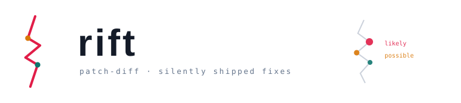
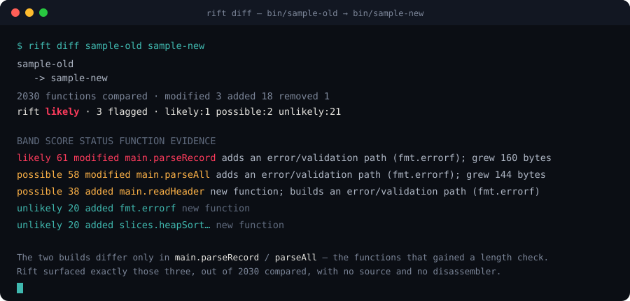
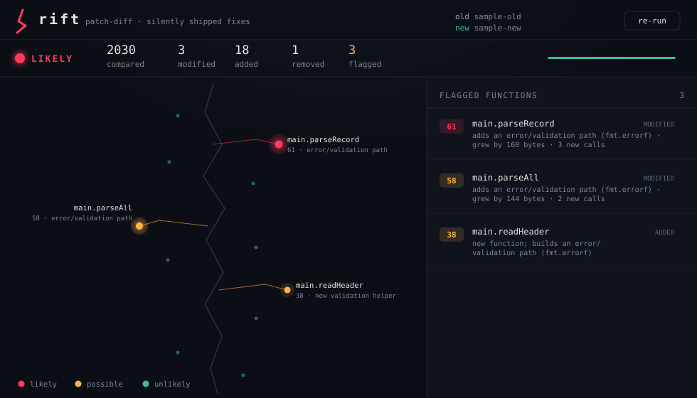
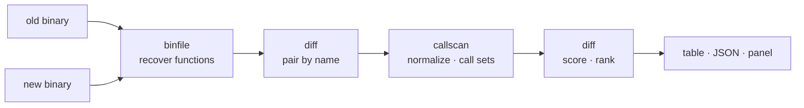

<picture>
  <source media="(prefers-color-scheme: dark)" srcset="docs/assets/wordmark-dark.svg">
  
</picture>

[](https://github.com/cansarihan/rift/actions/workflows/ci.yml)
[](https://github.com/cansarihan/rift/actions/workflows/codeql.yml)
[](https://goreportcard.com/report/github.com/cansarihan/rift)
[](go.mod)
[](LICENSE)

Rift compares two builds of the same program and finds the functions whose change
looks like a quietly shipped security fix. A vendor who patches a bug without
announcing it still ships the fix in the binary: the patched function is a little
longer than it was, and it calls something it did not call before. Rift pairs the
functions in the two builds by name, discards the differences that are only the
linker moving code around, and ranks what is left — turning a silent patch into a
short list of functions to look at first.

It needs no source and no disassembler. One binary with nothing outside the
standard library; it reads ELF, Mach-O and PE, and runs the same on Linux, macOS
and Windows.

## On the command line

```console
$ rift diff old-build new-build
old-build
   -> new-build
2030 functions compared  ·  modified 3  added 18  removed 1
rift likely  ·  3 flagged  ·  likely:1 possible:2 unlikely:21

BAND      SCORE  STATUS    FUNCTION          EVIDENCE
likely    61     modified  main.parseRecord  adds an error/validation path (fmt.errorf); grew by 160 bytes; 3 new calls
possible  58     modified  main.parseAll     adds an error/validation path (fmt.errorf); grew by 144 bytes; 2 new calls
possible  38     added     main.readHeader   new function; builds an error/validation path (fmt.errorf)
```



The two builds above differ in one source change — a length field that the new
build validates before it trusts it. Out of 2030 functions, Rift surfaces the
three that the change actually touched.

## The panel

`rift serve` hosts a panel that draws the comparison as a fault line between the
two builds. Every function that changed opens a rift off the line, glowing in the
colour of its suspicion band; a seismograph sweep runs while the comparison
streams in, and the side list names each flagged function with the evidence
behind its score.



## How scoring works

Rift grades a change on what it can actually read out of the machine code, not on
a guess about intent:

| Signal | Why it matters |
|---|---|
| The set of runtime bounds/overflow checks changed | A `runtime.panicBounds`-family call that appears, or one eliminated because the function now validates its inputs, is the clearest trace of a safety check moving |
| A new error or validation path | A call to an error constructor that was not there before is the shape of an added rejection path |
| The function grew | Added checks add code |
| New callees | New behaviour pulled in |

A change is scored from these and sorted into a band:

| Band | Meaning |
|---|---|
| `likely` | Several fix signals line up — disassemble this first |
| `possible` | One clear signal — worth a look |
| `unlikely` | A difference with little behavioural signal |

The bands are a triage order, not a verdict. Rift cannot tell whether a change
made the code safer or less safe — only that the checks around it moved, which is
exactly what you want to review. A change whose call set is unchanged, whose size
is unchanged and whose only difference is relocated addresses is treated as noise
and dropped, so the list stays short.

## How a diff runs



1. Both binaries are opened and their functions recovered from the symbol table,
   each sliced out of the `.text` section between consecutive symbols.
2. Functions are paired by name: present in both and different is *modified*,
   only in the new build is *added*, only in the old is *removed*.
3. For a modified pair the code is compared with layout-only operands masked, so
   relocation does not read as change; the call sets are diffed to find added and
   removed callees.
4. Each real change is scored on its evidence, and the comparison streams to a
   table, to JSON, or to the panel over server-sent events.

## Why the call set is the tell

In Go, a slice or index the compiler cannot prove in-bounds compiles to a call
into `runtime.panicBounds`. When a build adds an up-front length check, that call
may disappear; when it adds a rejection path, the function starts calling an error
constructor. Rift decodes just the direct calls — `CALL rel32` on amd64, `BL` on
arm64 — and resolves each target to a symbol, so it sees those calls appear and
vanish without disassembling the whole function.

## Commands

```console
$ rift diff old new           # compare two builds and grade the changes
    -json         print JSON instead of a table

$ rift inspect binary         # list what Rift recovers from one binary
    -json         print the function table as JSON

$ rift serve                  # host the panel and API over one comparison
    -old <file>      the earlier build
    -new <file>      the later build
    -listen <addr>   listen address (default 127.0.0.1:8080)
    -token <tok>     require a bearer token (or RIFT_TOKEN)
    -no-ui           serve the API without the panel

$ rift version
```

Flags come before the positional arguments, as the Go flag package expects:
`rift diff -json old new`.

## HTTP API

```console
GET  /api/v1/status               build info and the two binaries being compared
GET  /api/v1/scans                recent comparisons, newest first
POST /api/v1/scans                start a comparison of the two binaries
GET  /api/v1/scans/{id}           one comparison with every graded function
GET  /api/v1/scans/{id}/stream    server-sent events for a running comparison
```

## Run the demo

The demo builds two versions of a small length-prefixed record parser — one that
trusts the declared lengths, one that validates them — and compares them.

```sh
cd rift
make demo          # panel at http://127.0.0.1:18150
make demo-down
```

Or without Docker:

```sh
make run           # builds the samples and serves the panel on 127.0.0.1:8080
```

Rift flags `main.parseRecord` and `main.parseAll` — the two functions that gained
a bounds check — and nothing else of substance, out of two thousand compared.

## Build

```sh
make build         # ./bin/rift
make test          # unit and integration tests
make race          # tests under the race detector
make lint          # golangci-lint
```

Rift reads binaries and never runs them.

## License

MIT. See [LICENSE](LICENSE).
