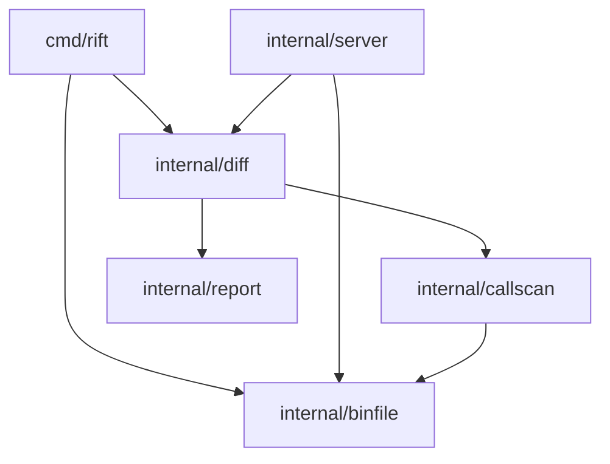

# Architecture

Rift is a short pipeline: two binaries become two sets of functions, the
functions are paired by name, and each pair that differs is graded by how much
its change looks like a quietly shipped security fix. Each stage is a package
with one responsibility, and the `diff` package drives them and turns the result
into updates for the command line and the panel.

## The idea

A vendor who fixes a bug without saying so still leaves the fix in the binary.
If you have the build from before and the build from after, the function that
was patched is sitting there in the symbol table, a few bytes longer than it
was, now calling something it did not call before. Rift pairs the functions by
name, throws away the differences that are only the linker moving things around,
and ranks what is left.

The hard part is telling a real change from relocation noise. When a build grows
by one function, every later function shifts, so every relative call and branch
inside them points somewhere new even though the code is identical. A naive byte
compare flags thousands of functions. Rift masks the operands that depend only
on layout before comparing, so an unchanged function reads as unchanged.

## Packages

- `internal/binfile` opens an executable — ELF, Mach-O or PE — and recovers its
  functions from the symbol table. Each function is a name, a virtual address
  and the slice of `.text` that implements it, sliced between consecutive
  symbols. It reads only the file; it never runs it.
- `internal/callscan` recovers the direct calls a function makes without a full
  disassembler. It decodes the one instruction that matters — the direct call,
  `CALL rel32` on amd64 and `BL` on arm64 — and resolves each target back to a
  symbol. It also produces the *normalized* form of a function: a copy with
  call and branch displacements, and arm64 `ADRP` page immediates, zeroed, so
  layout shifts do not register as code changes.
- `internal/diff` pairs the two function sets by name and classifies each pair
  as modified, added or removed. For a modified pair it compares the normalized
  code, computes the churn, and diffs the call sets. It scores a change on the
  evidence that marks a fix: a change to the set of runtime bounds and overflow
  checks, a new error or validation path, meaningful growth, new callees. It
  drops changes that carry no behavioural signal, and ranks the rest worst
  first.
- `internal/report` renders a summary as a table or as JSON.
- `internal/server` wraps the engine in an HTTP API and serves the embedded
  panel. It compares two fixed binaries chosen at startup, so a request can
  never point it at an arbitrary path on the host. Each comparison keeps a
  bounded event feed the panel follows over server-sent events.

## How a function is scored

The strongest evidence is the call set. In Go, a slice or index whose safety the
compiler cannot prove compiles to a call into `runtime.panicBounds` (and its
siblings); a function that validates its inputs up front may let the compiler
drop that call, and a function that adds a rejection path starts calling an error
constructor. Either change to the call set is what a fix looks like from the
outside, so a changed guard set or a new error path dominates the score. Growth
and churn refine it. A change with no call-set delta, the same size and only a
little residual churn is treated as relocation noise and dropped.

The grades are deliberately a triage aid, not a verdict: `likely`, `possible`
and `unlikely` rank which functions to disassemble first, in a human's order.

## What it does not do

Rift decodes one instruction, the direct call. It does not follow indirect or
virtual calls, it does not recover data-flow, and it cannot tell whether a
change made the code safer or less safe — only that the checks around it moved.
It pairs functions by symbol name, so it needs symbols on both sides; a fully
stripped binary gives it nothing to pair.
